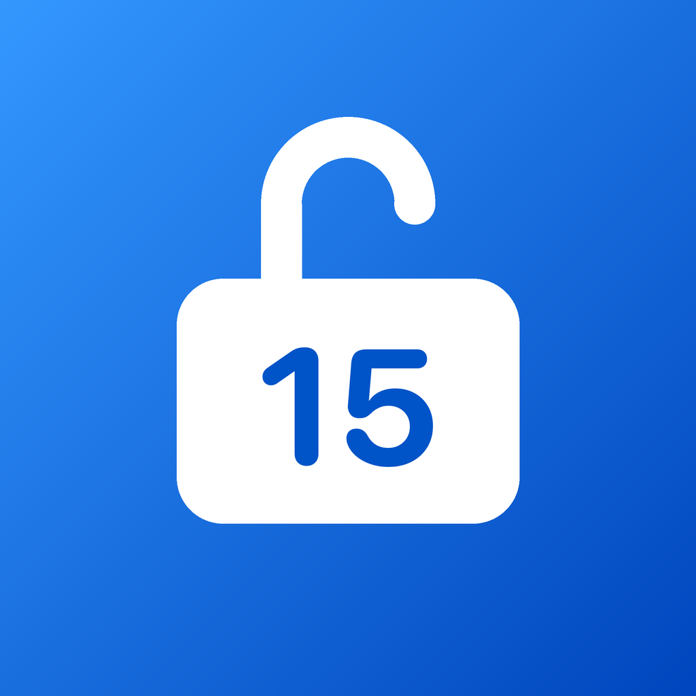
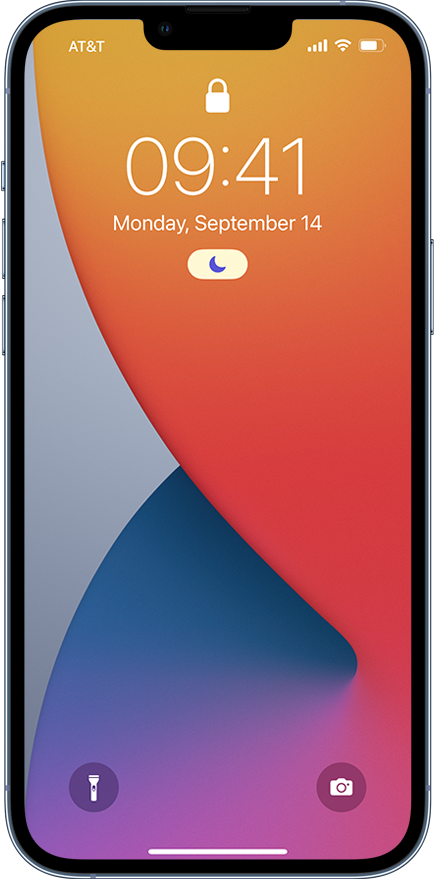
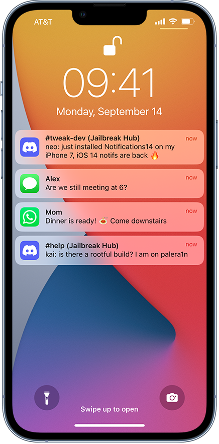
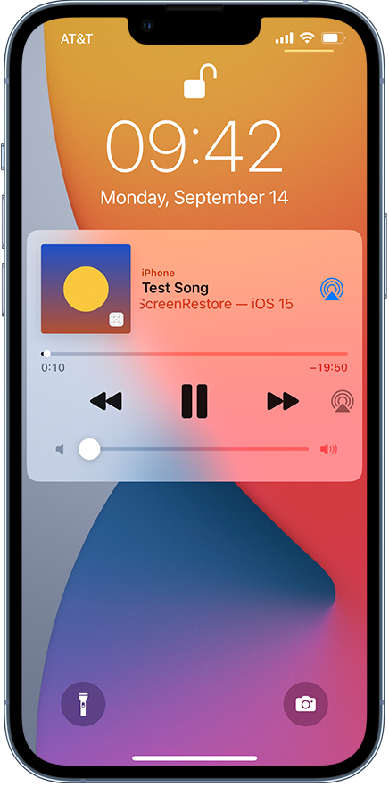

<p align="center">
  
</p>

<h1 align="center">LockScreenRestore</h1>

<p align="center">
  <a href="../../releases/latest"></a>
  <a href="https://aronsz26.github.io/"></a>
  
  
  <a href="LICENSE"></a>
</p>

Brings the iOS 15 lock screen back to iOS 16: clock, notifications, music player, unlock animation, live and dynamic wallpapers and the old **Settings → Wallpaper** page. Every part has its own switch.

<p align="center">
  
  &nbsp;
  
  &nbsp;
  
</p>

## Links

| | |
| --- | --- |
| Sileo / Zebra repo | `https://aronsz26.github.io/` |
| Download | [latest release](../../releases/latest) (`.deb`) |
| Help | [issues](../../issues): please add your model, iOS version and a screenshot |

## What it changes

| | |
| --- | --- |
| Clock | thin iOS 15 clock and date, big padlock, no depth effect or widgets |
| Focus | the Focus pill under the date |
| Notifications | iOS 15 cards right under the clock, Notification Centre on swipe up, pull down for search |
| Music player | iOS 15 layout with large artwork, AirPlay and volume slider |
| Unlock | the home screen wallpaper follows your swipe |
| Wallpaper | live, dynamic and still wallpapers with Perspective Zoom, separate lock and home screen, the iOS 15 Settings → Wallpaper page with downloads |
| Home screen | the lighter iOS 15 shadow under app names |

Switches are in **Settings → Tweaks → LockScreenRestore** and apply after **Apply (Respring)**. Apple's wallpapers are not in this repository; the Wallpaper page downloads them from the [SniperGER/iOS-Wallpapers](https://github.com/SniperGER/iOS-Wallpapers) archive.

## Devices

| iPhone | iOS | Status |
| --- | --- | --- |
| 13 Pro, 12 Pro | 16.1.1, 16.5 | tested |
| X, 11, 8 Plus | 16.7, 16.1, 16.2 | reported working by users |
| other iPhones without Dynamic Island | 16.x | should work, untested |
| 14 Pro and newer (Dynamic Island) | 16.x | installs, but not adjusted |

Rootless jailbreaks (tested with Dopamine) on iOS 16 only; the package does not install on iOS 17 and later.

> [!NOTE]
> Support for iOS 17 and later is planned. I'm busy with other projects right now, so it will take a while.

> [!TIP]
> If your iPhone lands in Safe Mode, turn the part that caused it off in the tweak's settings or uninstall the package, and please open an issue.

## Building

```bash
export THEOS=~/theos
make package FINALPACKAGE=1
```

Needs [Theos](https://theos.dev) and the iOS 16.5 SDK. Without `FINALPACKAGE=1`, debug tools for SSH testing are built in (`DebugTools.m`).

## License

[MIT](LICENSE)
