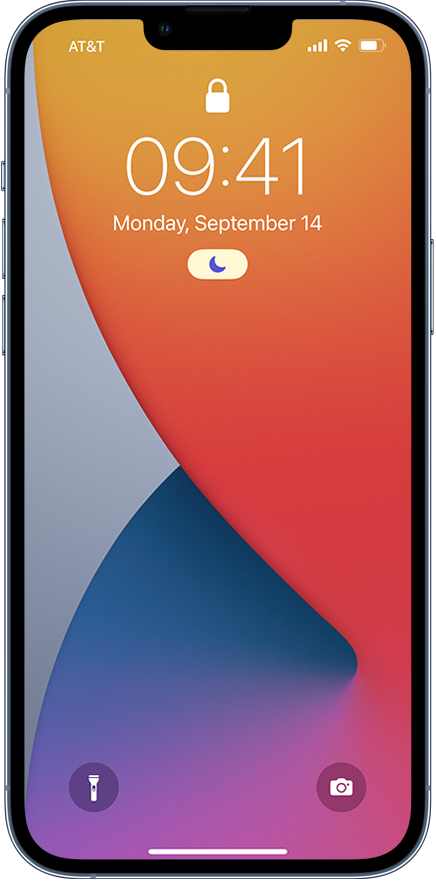
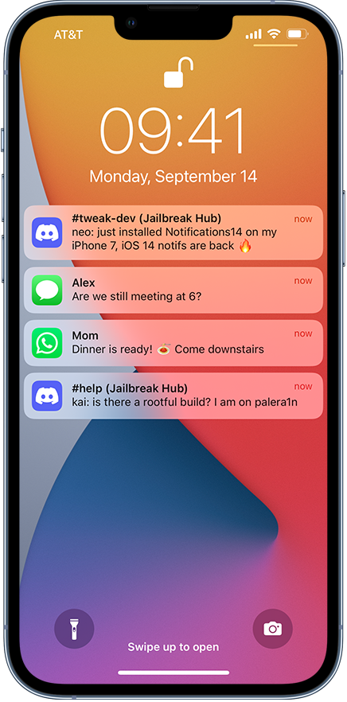
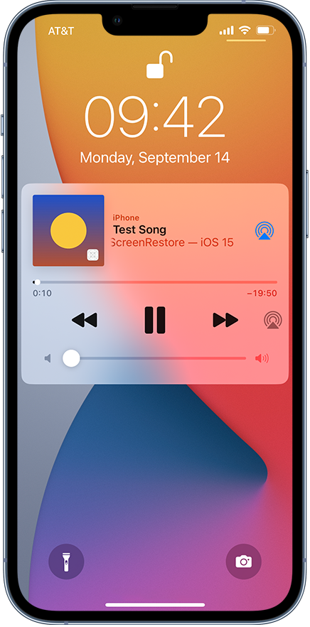

# LockScreenRestore

Brings the iOS 15 lock screen back to iOS 16: clock, notifications, music player, unlock animation, live and dynamic wallpapers and the old **Settings → Wallpaper** page.

<p align="center">
  
  &nbsp;
  
  &nbsp;
  
</p>

> [!NOTE]
> This page describes **1.9.5 beta 6**. The stable version is 1.9.4; betas are on the [releases page](../../releases).
> iPhones with a Dynamic Island (14 Pro and newer) are not supported yet.

## What it changes

Every part has its own switch, so you can mix iOS 15 and iOS 16.

### 🕘 Clock
- Thin iOS 15 clock in iOS 15's own font, the date below it, plain white
- Big padlock that stays open after Face ID
- No depth effect and no lock screen widgets
- The charging battery appears where the clock is

### 🌙 Focus
- The Focus pill sits under the date instead of the Focus name at the bottom

### 🔔 Notifications
- Listed right under the clock, always as a list
- iOS 15 card shape: 18.5 pt corners, tighter padding
- **Notification Centre** and its ✕ only appear when you swipe up

### 🎵 Music player
- The iOS 15 layout with the sizes of iOS 15's player: large artwork with the app's icon, device name above the title, AirPlay next to it
- Progress bar with a knob, bigger buttons and the **volume slider**

### 🔓 Unlock animation
- The home screen wallpaper follows your swipe, and the lock screen only blurs when the two wallpapers differ

### 🖼️ Wallpaper
- **Live** wallpapers: press and hold the lock screen to play
- **Dynamic** wallpapers: iOS 15's animated bubbles, drawn by iOS 15's own view
- **Perspective Zoom** as on iOS 15, and a Light and a Dark version that follow the system appearance
- Different wallpapers for the lock screen and the home screen
- **Settings → Wallpaper** is the iOS 15 page again: *Choose a New Wallpaper* with Dynamic, Stills, Live and your photo albums, iOS's own preview with **Set Lock Screen / Home Screen / Both**, and *Dark Appearance Dims Wallpaper*
- On iPhone Plus models the wallpaper turns with the home screen

## Settings

**Settings → Tweaks → LockScreenRestore** has one switch per part (Clock, Focus, Notifications, Music Player, Unlock Animation, Live Wallpaper), all on by default, and:

- **Clock Size**: 0.7 to 1.5 times iOS 15's size
- **Fix Positions**: shows the detected iPhone and recalculates all positions
- **Reset to Defaults**

Switches apply after **Apply (Respring)**. Wallpapers are picked in **Settings → Wallpaper**.

## Wallpapers

Apple's wallpapers are copyrighted and not part of this repository or the package.

- **Stills and Live**: *Choose a New Wallpaper* lists Apple's iOS 14/15 wallpapers under **Available to Download** (from the [SniperGER/iOS-Wallpapers](https://github.com/SniperGER/iOS-Wallpapers) archive). Tap one to download it and open the preview.
- **Dynamic**: no download, iOS 16 still ships them.
- **Photos** from your library work too, with Move & Scale.

To add one by hand, put `Light.heic` and `Dark.heic` (plus `Light.mov` and `Dark.mov` for a live wallpaper) into a folder in `/var/mobile/Library/LockScreenRestore/Wallpapers/`. The folder's name is the wallpaper's name.

## Compatibility

Rootless jailbreaks on **iOS 16**. Tested with Dopamine on:

- iPhone 13 Pro (iOS 16.1.1) and iPhone 12 Pro (iOS 16.5)
- by users: iPhone X (iOS 16.7), iPhone 11 (iOS 16.1), iPhone 8 Plus (iOS 16.2)

Other iPhones without a Dynamic Island get sizes and positions for their screen but are untested. If you try one, please [open an issue](../../issues) with your model, iOS version, jailbreak and a screenshot, even if everything looks right.

## Installation

Add the repo to Sileo or Zebra and install LockScreenRestore:

```
https://aronsz26.github.io/
```

Or download the `.deb` from the [releases page](../../releases) and open it with Sileo, Zebra or Filza. PreferenceLoader is installed automatically.

If your iPhone lands in Safe Mode, turn the part that caused it off in the tweak's settings or uninstall the package, and please [open an issue](../../issues).

## Known limitations

- No Dynamic Island support: the tweak installs there, but nothing is adjusted for it.
- Landscape on Plus models is new; the direction of Perspective Zoom and of the bubbles' motion is untested there.
- Live wallpapers play through the tweak's own player, not iOS 15's.
- With Live Wallpaper on, the long press no longer opens iOS 16's lock screen editor.
- The home screen preview in Settings → Wallpaper is a small screenshot taken when you unlock; it stays on your iPhone.
- Downloads depend on the wallpaper archive being online.
- Other tweaks that change the same parts of the lock screen may conflict.

## Building

You need [Theos](https://theos.dev) and the iOS 16.5 SDK.

```bash
git clone https://github.com/aronsz26/LockScreenRestore.git
cd LockScreenRestore
export THEOS=~/theos
make package FINALPACKAGE=1
```

`Tweak.xm` is the lock screen, `LSRWallpaperPane.xm` the Settings → Wallpaper page and `lockscreenrestoreprefs/` the tweak's settings. Without `FINALPACKAGE=1`, `DebugTools.m` is built in too: it inspects the running processes over SSH (see the comment at its top).

## How it works

iOS 16 still ships much of iOS 15, mostly for the iPad, and the tweak uses those parts where they exist: the bubbles view and the still wallpaper view with Perspective Zoom (`PBUIBokehWallpaperView`, `PBUIStaticWallpaperView`), the wallpaper preview (`SBSUIWallpaperPreviewViewController`), the clock's font and the unlock transition's settings.

Where iOS 16 has nothing left, like the music player's layout or the notification cards, the tweak adjusts iOS 16's views to the sizes read from a real iOS 15 lock screen. Clock size and position per iPhone follow iOS 15's own rules and are worked out each time SpringBoard starts.

## License

[MIT](LICENSE)
